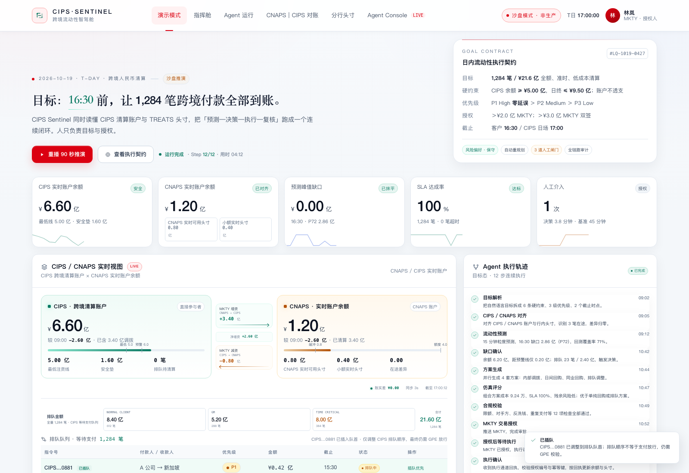
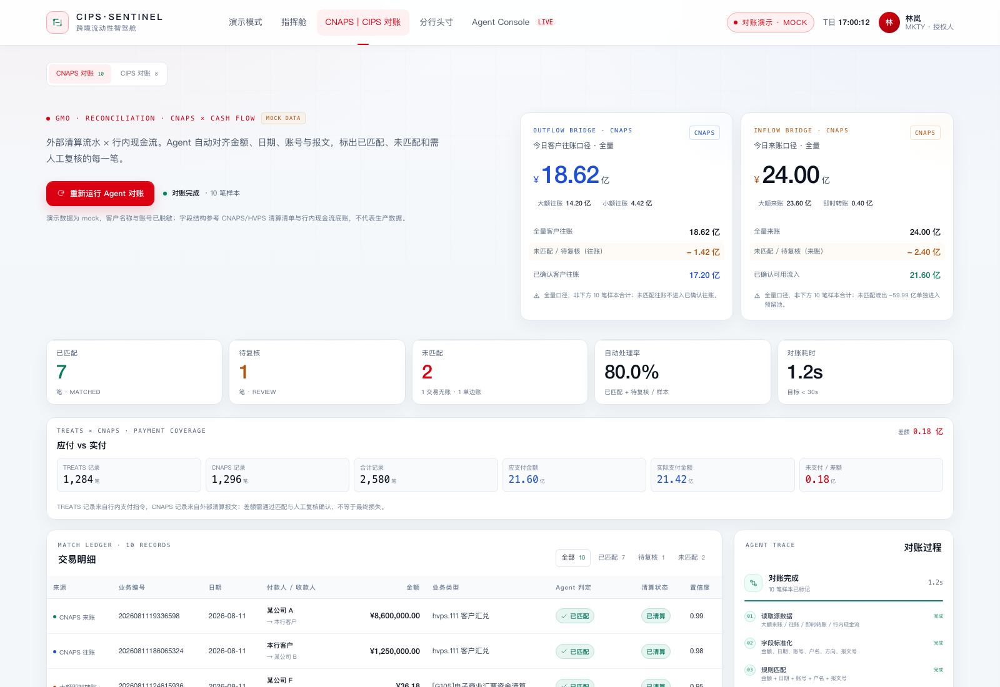
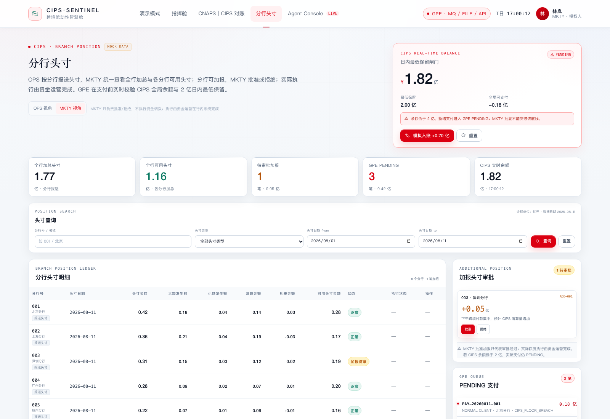
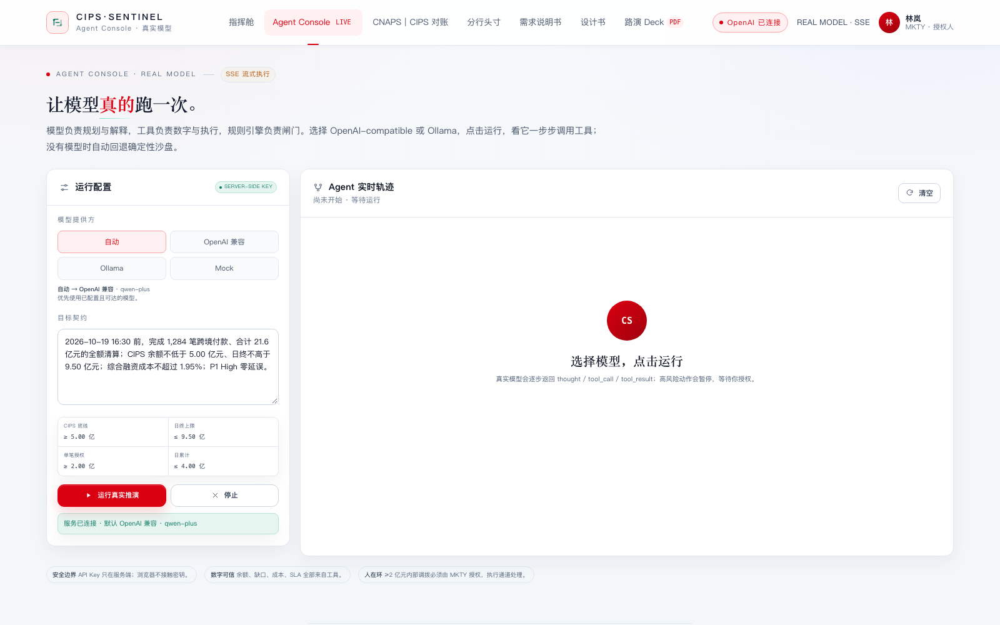

# CIPS Sentinel

**跨境流动性管理多步 Agent · 可运行 Demo**

CIPS Sentinel 把 CIPS 跨境清算账户、CNAPS 境内清算账户、TREATS 行内资金池和 GPE 支付执行状态放在同一条业务链上，演示一个受控、可审计的多步 Agent：

```text
目标契约
  → 数据核验
  → 对账 / 头寸 / 预测
  → 方案与规则校验
  → MKTY 人工授权
  → 执行通道交接
  → GPE / CIPS 流动性闸门
  → 监控与日终复盘
```

> 本项目使用 Mock / 沙盘数据，不连接真实 CIPS、CNAPS、TREATS、GPE 或生产账户。
> 不包含真实客户、账户、员工或交易数据。

---

## 页面预览

### 首页 / 指挥舱



### CNAPS / CIPS 对账



### 分行头寸



### Agent Console



---

## 功能

- **首页 / 指挥舱**：目标契约、KPI、CIPS/CNAPS 水位、排队队列、Agent 执行轨迹。
- **CNAPS / CIPS 对账**：匹配、待复核、未匹配、同金额候选、应付 vs 实付。
- **分行头寸**：OPS / MKTY 视角、加报审批、2 亿最低保留线、GPE PENDING。
- **Agent Console**：真实模型 / Ollama / Mock 切换，SSE 流式 thought / tool_call / tool_result，MKTY 暂停点。
- **流动性预测 v0.1**：90 天 15 分钟沙盘历史、季节性基线、残差 bootstrap、P50 / P72 / P95、滚动回测。
- **CNAPS 来账趋势**：3M / 6M 历史、5 日预测、匿名客户机会视图。
- **审计与回放**：步骤、工具、Observation、人工授权、执行回执和异常状态可查看。

---

## 快速启动

### 1. 环境

- Node.js **20+**（推荐 22 LTS）
- 浏览器：Chrome / Edge
- 可选：Ollama（本地模型）、Python 3.10+（仅用于重新生成文档）

服务端是零依赖 Node ESM，不需要 `npm install`。

### 2. 克隆

```bash
git clone https://github.com/cxkyang/CIPS-Sentinel.git
cd CIPS-Sentinel
```

### 3. 配置

```bash
cp .env.example .env.local
```

编辑 `.env.local`：

```env
# 最稳定的演示方式：不调用模型，使用确定性 Mock
LLM_PROVIDER=mock

# 或使用 OpenAI-compatible 模型
LLM_PROVIDER=openai
LLM_API_KEY=your-key
LLM_MODEL=qwen-plus

# 或使用本地 Ollama
LLM_PROVIDER=ollama
OLLAMA_BASE_URL=http://127.0.0.1:11434/v1
OLLAMA_MODEL=qwen2.5:7b
```

不要把 `.env.local` 提交到 Git。

### 4. 启动

macOS / Linux：

```bash
./run.sh
```

或：

```bash
node server.mjs
```

Windows PowerShell：

```powershell
Copy-Item .env.example .env.local
node server.mjs
```

启动后打开：

```text
http://127.0.0.1:8787/
```

页面：

```text
/                 首页 / 指挥舱
/recon.html       CNAPS / CIPS 对账
/tops.html        分行头寸
/live.html        Agent Console
```

健康检查：

```bash
curl http://127.0.0.1:8787/api/health
```

完整安装、配置、Docker 和故障排查见 [RUNBOOK.md](RUNBOOK.md)。

---

## 文档

- [项目需求说明书（16 页 PDF）](docs/CIPS-Sentinel-需求说明书-v1.0.pdf)
- [项目需求说明书（PPTX）](docs/CIPS-Sentinel-需求说明书-v1.0.pptx)
- [需求说明书源文件（DOCX）](docs/source/CIPS_Sentinel_项目需求说明书_v1.0_转录版.docx)
- [项目设计书（PDF）](docs/CIPS-Sentinel-项目设计书-v1.0.pdf)
- [项目设计书（DOCX）](docs/CIPS-Sentinel-项目设计书-v1.0.docx)
- [路演 Deck（PDF）](docs/CIPS-Sentinel-路演-Deck-v1.0.pdf)
- [路演 Deck（PPTX）](docs/CIPS-Sentinel-路演-Deck-v1.0.pptx)
- [6 页方案稿（PDF）](docs/HSBC-CIPS-Sentinel-6页.pdf)
- [6 页方案稿（PPTX）](docs/HSBC-CIPS-Sentinel-6页.pptx)

---

## 架构

```text
浏览器
  ├─ index.html / app.js
  ├─ recon.html / recon.js
  ├─ tops.html / tops.js
  └─ live.html / live.js
          │ SSE / REST
          ▼
      server.mjs  (Node ESM · 零依赖)
          ├─ 静态文件服务
          ├─ /api/health
          ├─ /api/agent/run
          ├─ /api/agent/approve
          ├─ ReAct 工具循环（16 步上限 + final 收口）
          └─ 工具层
               ├─ CIPS / CNAPS / TREATS 查询
               ├─ 对账 / 头寸 / 预测 / 方案 / 规则校验
               ├─ MKTY 人工授权
               └─ 执行通道回执
          │
          ▼
      forecast/
        ├─ 15 分钟流动性预测
        ├─ CNAPS 3M / 6M 来账趋势
        └─ 客户机会视图
```

模型只负责规划和解释；余额、金额、成本、预测、规则校验来自工具和沙盘数据。

---

## 仓库结构

```text
.
├── server.mjs                 # 零依赖 Node 服务 + Agent 循环
├── index.html / app.js        # 首页 / 指挥舱
├── recon.html / recon.js      # CNAPS / CIPS 对账
├── tops.html / tops.js        # 分行头寸
├── live.html / live.js        # Agent Console
├── styles.css / light.css     # 页面样式
├── forecast/                  # 预测、回测、趋势与快照
├── docs/                      # 需求说明书 / 设计书 / 路演材料
├── assets/                    # README 截图
├── .env.example               # 环境变量样例
├── Dockerfile
├── RUNBOOK.md                 # 运行说明
└── package.json
```

---

## 数据与边界

- 所有页面使用 Mock / 沙盘数据。
- 预测与回测是沙盘验证，不代表生产 SLA 或真实收益。
- 客户机会为匿名样本与规则判断，不构成授信、投资或获客结论。
- 不连接生产系统，不发送真实支付、调拨或回购指令。
- `.env.local` 只保存在本机，API Key 不下发到浏览器。

---

## License / 使用范围

本项目用于比赛与内部演示。涉及 HSBC 名称、Logo 或商标的材料仅用于对应项目材料，不代表 HSBC 官方发布。
